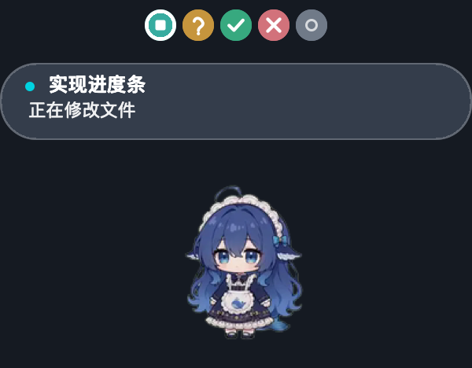
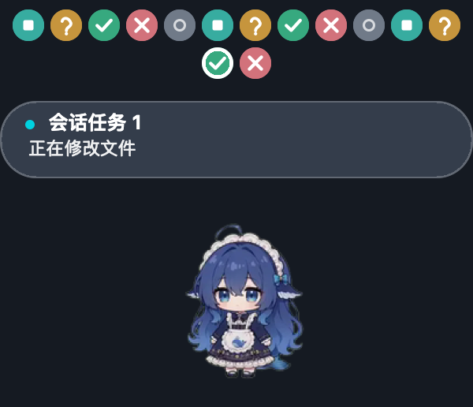

# DSH ALK Pet

让 DeepSeek Harness 的任务状态变成一只始终陪在桌面上的小宠物。

DSH ALK Pet 是一个**非官方** DeepSeek Harness（DSH）插件：在 macOS 和 Windows 上优先使用跨应用置顶的原生透明悬浮窗；原生窗口不可用时，自动回退到 DSH 页面右下角。它不只是播放动画，还能把多个会话、子 Agent、待办步骤和工具动作汇总成一块可视化任务看板。

## 特色功能

- **用动画展示真实任务状态**：根据 DSH 会话事件切换待机、思考、工作、等待确认、完成和错误动作，约 12 帧/秒播放。
- **多任务一眼可见**：同时运行多个顶层会话时，以状态圆点展示每个任务；每行最多 12 个，超过后自动换行，并自动轮播当前任务。
- **鼠标悬停即可切换任务**：移入圆点立即查看对应任务，悬停期间暂停轮播，移开约 2 秒后恢复。
- **了解 Agent 正在做什么**：气泡第一行显示顶层会话标题，第二行显示当前待办、执行步骤或工具动作及其关键参数。
- **正确归并子 Agent**：子 Agent 的活动会归入所属顶层会话，不会产生难以辨认的额外任务项。
- **结果不会一闪而过**：完成或失败状态会保留，直到你打开相应会话并查看结果。
- **原生悬浮与网页回退**：macOS、Windows 使用可拖动的原生置顶窗口；启动失败时自动切换为页面内宠物。
- **兼顾无障碍与省电**：可关闭气泡、调整尺寸，或启用静态单帧的“减少动态效果”模式。

## 预览





## 使用方法

### 1. 安装插件

在 DeepSeek Harness 桌面端打开插件页面，选择“添加插件”，输入本项目目录的**绝对路径**，然后安装并启用。

开发者也可以先退出桌面端，再使用桌面端自带的 `dsh` 命令安装：

```sh
dsh plugin --profile desktop add /absolute/path/to/dsh-alk-pet
```

插件同时兼容 WebUI 客户端插槽。桌面端和 WebUI 使用不同的 profile，需要分别安装：

```sh
dsh plugin --profile web add /absolute/path/to/dsh-alk-pet
```

发布到 npm 后，也可以直接使用包名：

```sh
dsh plugin --profile web add dsh-alk-pet
```

### 2. 重启并使用

安装或修改配置后，重启 Host 并刷新客户端。此后正常使用 DSH 即可：插件会自动监听会话状态，不需要手动启动宠物。

- 拖动宠物可改变位置。
- 多任务时，将鼠标移到状态圆点上可切换任务。
- 待机时气泡自动隐藏。
- 完成或失败后，打开对应 DSH 会话查看结果，该任务圆点随后移除。

位置会自动保存：macOS 使用 `UserDefaults`，Windows 使用 `%LOCALAPPDATA%\dsh-alk-pet\window.json`，网页回退版本使用当前客户端的 `localStorage`。窗口尺寸变化后，宠物会自动回到可见区域内。

### 3. 修改设置

默认设置位于 `cordis.patch.yml`：

| 配置项 | 默认值 | 说明 |
| --- | ---: | --- |
| `enabled` | `true` | 是否启用宠物；关闭后不启动原生窗口，也不渲染网页回退版本 |
| `size` | `120` | 宠物尺寸，取值会自动限制在 72–200 之间 |
| `reducedMotion` | `false` | 只显示动画第 1 帧，适合减少动态效果或降低资源消耗 |
| `showBubble` | `true` | 是否显示标题与动作气泡；任务状态圆点不受影响 |

修改后请重启 Host 并刷新客户端。

## 状态说明

| 状态 | 圆点样式 | 含义 |
| --- | --- | --- |
| 运行中 | 青绿色圆点、白色小方块 | Agent 正在思考、执行步骤或调用工具 |
| 等待确认 | 琥珀色问号 | 需要用户输入、授权或确认 |
| 成功 | 绿色勾 | 当前任务已完成 |
| 失败 | 玫瑰红叉 | 当前任务遇到错误 |
| 待机 | 灰色圆环 | 当前没有活动任务 |

选中的任务会显示白色描边。轮播时，气泡宽度会按照所有任务中的最长内容计算并保持稳定，最大不超过 300px；悬停某个任务时，则按当前任务内容计算。

## 权限与安全

插件的本地接口设计用于本机访问，不提供账号登录或远程鉴权能力。所有 HTTP 接口（`/plugins/dsh-alk-pet/*`）只检查 TCP 对端是否为回环地址（`127.0.0.1` / `::1`）。因此：

- 仅建议配合本机直连的 WebUI 使用。
- **不要**将 WebUI 暴露到不受信任的网络。
- **不要**把插件的回环地址检查视为登录鉴权或访问控制。

Windows 原生窗口通过 PowerShell 启动，并使用分层窗口实现逐像素透明。若系统策略禁止运行 PowerShell 脚本，插件会自动回退到网页内宠物。

随包提供的 macOS Helper 当前为 Apple Silicon 版本。Intel Mac 会自动回退到网页版本，也可以使用本机工具链重新构建。Linux 不提供原生悬浮窗，仅使用 WebUI 页面内版本。原生窗口异常退出时会自动重启两次；仍无法运行则自动回退。

## 授权与声明

- 项目代码采用 [MIT License](LICENSE) 发布，可在保留版权与许可声明的前提下使用、复制、修改、合并、发布、分发、再许可或销售。
- 角色动画素材来自 [PC2005-cloud/dsh-pet](https://github.com/PC2005-cloud/dsh-pet)，使用参考仓库 `dsh-dafeiyu` 导出的六组动作帧，同样按 MIT 许可分发；原始版权与许可文本见 [assets/LICENSE.txt](assets/LICENSE.txt)。
- 本项目是社区维护的非官方插件，与 DeepSeek 官方无关，也不代表 DeepSeek 官方立场。
- 软件按“原样”提供，不附带任何明示或默示担保；完整条款以许可证原文为准。

## 开发

环境要求：Node.js 20 或更高版本。

```sh
npm test                 # 运行状态机、任务板、运行时、HTTP 接口、客户端布局与素材测试
npm run build:assets     # 归一化动画背景 alpha，并重新生成素材 manifest
npm run check:assets     # 校验素材与 manifest 是否为最新状态（适用于 CI）
npm run build:native     # macOS：重新构建原生 Helper
```

动画帧数、帧间隔和素材版本统一记录在 `assets/animations/manifest.json`。Host 启动时读取该文件，并通过 SSE 或原生消息下发；它是动画元数据的唯一权威来源。

素材帧的背景 alpha 必须完全为 0，否则 Windows 分层窗口可能出现底噪。`npm run build:assets` 会自动把 alpha 小于 8 的像素清零。

macOS Helper 支持截图预览模式：

```sh
DSH_ALK_PET_SNAPSHOT=/tmp/pet.png ./runtime/bin/darwin/dsh-alk-pet-helper ./assets/animations
```

Helper 收到首条消息后会将整个悬浮层渲染为 PNG 并退出，便于检查视觉效果。若本机 CommandLineTools 出现 “this SDK is not supported by the compiler” 的工具链与 SDK 版本错配，构建脚本会创建临时 SDK 副本并自动修补后重试，不会修改系统文件。
